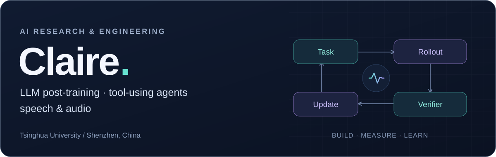
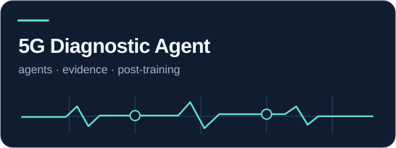
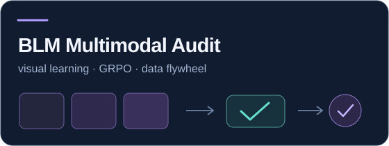
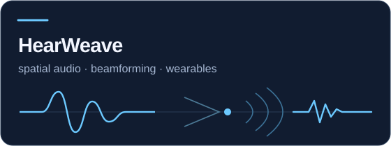
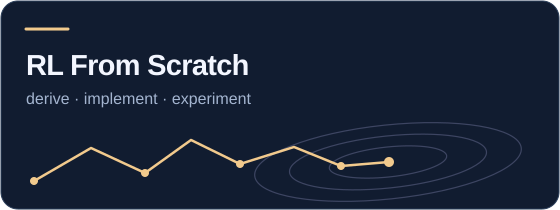
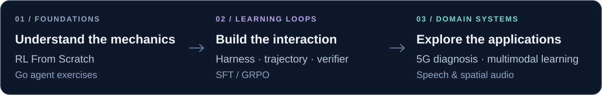

  

  <a href="https://wonderfulclaire.github.io/academic-homepage/">Academic homepage</a> &nbsp;·&nbsp;
  <a href="mailto:wk1924321@163.com">Email</a> &nbsp;·&nbsp;
  <a href="https://x.com/ClaireWangke">X</a>

I'm an M.S. student at **Tsinghua University**, based in Shenzhen. I work on **LLM post-training and tool-using agents**, with a background in **multimodal learning and speech/audio processing**.

I like turning ideas into systems you can run, inspect, and improve—from learning objectives and agent interactions to training code and experiment reports.

## Featured study · Foundation models

**[Kimi K3 · Deep Dive & Lab](https://github.com/WonderfulClaire/kimi-k3-deep-dive)** is my focused study of foundation model mechanisms, from KDA memory and AttnRes to MoE routing. I connect source-grounded derivations with runnable NumPy experiments, a pre-training and systems guide, and an agentic post-training lab.

[Learning route](https://github.com/WonderfulClaire/kimi-k3-deep-dive/blob/main/docs/foundation-models/README.md) · [Numerical report](https://github.com/WonderfulClaire/kimi-k3-deep-dive/blob/main/reports/mechanisms/REPORT.md) · [Pre-training & systems](https://github.com/WonderfulClaire/kimi-k3-deep-dive/blob/main/docs/foundation-models/04-pretraining-systems.md) · [Agent Lab](https://github.com/WonderfulClaire/kimi-k3-deep-dive/blob/main/docs/experiments.md)

## Selected work

| Agents & post-training | Multimodal learning |
| :--- | :--- |
|  |  |
| Multi-turn diagnosis with evidence-guided tools, LoRA-SFT/GRPO, and trajectory-level evaluation. | Visual representation learning, distributed contrastive training, and a reviewed data flywheel. |
| [Learning loop](https://github.com/WonderfulClaire/5G-Diagnostic-Agent/blob/main/docs/LEARNING_LOOP.md) · [Experiments](https://github.com/WonderfulClaire/5G-Diagnostic-Agent/blob/main/docs/EXPERIMENT_PROTOCOL.md) | [Data flywheel](https://github.com/WonderfulClaire/BLM-Multimodal-Audit/blob/main/docs/DATA_FLYWHEEL.md) · [Distributed training](https://github.com/WonderfulClaire/BLM-Multimodal-Audit/blob/main/reports/distributed/20260915/REPORT.md) |
| **Speech & spatial audio** | **Reinforcement learning** |
|  |  |
| Microphone-array simulation, beamforming, localization, and reproducible wearable-audio experiments. | Derivations and NumPy/PyTorch implementations, from Bellman equations to PPO, GRPO, and agentic post-training. |
| [Tutorial](https://github.com/WonderfulClaire/HearWeave/blob/main/docs/TUTORIAL.md) · [BeamBench](https://github.com/WonderfulClaire/BeamBench) | [Learning path](https://github.com/WonderfulClaire/rl-from-scratch#readme) · [Agentic post-training](https://github.com/WonderfulClaire/rl-from-scratch/tree/main/12_agentic_post_training) |

## A connected research toolkit

  

The common thread is **learning from interaction**: build an environment, follow the signal through the update, and measure what changes.

Explore more: [Go agent exercises](https://github.com/WonderfulClaire/agent-hard-way) · [JobNebula](https://github.com/WonderfulClaire/JobNebula) · [Research training guide](https://github.com/WonderfulClaire/research-training-guide) · [Learning hub](https://github.com/WonderfulClaire/claire-learning-hub)
